<div align="center">


# Mindly

**The coordination layer for teams of coding agents.**

[Quickstart](#quickstart) · [What it does](#what-it-does) · [Commands](#commands) ·
[Configuration](#configuration) · [How it works](#how-it-works) · [Security](#privacy-and-security) ·
[Changelog](CHANGELOG.md)

[](https://www.npmjs.com/package/mindly-cli)
[](LICENSE)
[](#quickstart)

```bash
npx mindly-cli init
```

</div>

Run Claude Code, Codex, Cursor and Gemini CLI on the same codebase without them overwriting each
other, breaking each other's work, or forgetting what the project decided. Mindly sits in each
agent's hooks, keeps one shared record of the project, and steps in at the moment it matters,
before the edit, not after the incident. Open source, and everything stays on your machine.

|                                     |                                                                                                     |
| ----------------------------------- | --------------------------------------------------------------------------------------------------- |
| **Change warnings**                 | When one agent changes a function, every agent with code that uses it is told before its next step. |
| **Decisions that check themselves** | Turn a decision into a check that runs after every edit, and alert every agent when it breaks.      |
| **Enforced rules**                  | Block writes that break a rule you marked as enforced, in every connected agent.                    |
| **Bisect for agent edits**          | Find the exact agent edit that broke a command, who made it and from which prompt.                  |
| **Sentinel**                        | Run your checks in the background as agents edit, and tell the agent whose edit broke one.          |
| **Split**                           | Divide one goal across agents in separate worktrees, with file ownership and merge checks.          |
| **Usage-limit handoff**             | When an agent hits its limit, the next one starts with the goal, plan, files and next steps.        |
| **Shared rules and memory**         | Rules and decisions every agent starts with, labelled by who said them and whether you approved.    |

<p align="center"></p>

## Why

One agent is a tool. Three agents on one repository are a team, and they have the problems of a
team that never talks to each other:

- One agent changes a shared interface while another is halfway through code that depends on it.
  Nobody finds out until CI fails, or production does.
- The decisions behind your codebase ("webhooks must verify signatures", "applied migrations are
  never edited") live in one agent's chat history and nowhere else.
- An agent hits its usage limit in the middle of a migration, and the next one starts from zero.
- Something broke after 140 agent edits across three tools, and none of it was committed.
  `git bisect` can't help, because the edits aren't commits.

## Quickstart

You need **Node.js 22.16 or newer, or 24 or newer** (Node 23 is not supported) and **git**, on macOS or Linux.

**1. Install**

```bash
npm i -g mindly-cli
```

**2. Connect your agents** (run inside your repository)

```bash
mindly init
```

`init` finds the agents you have installed, shows every file and line it will change, and asks
before writing anything. It also offers to import the rules you already wrote in `CLAUDE.md`,
`AGENTS.md`, `.cursorrules` and similar files.

**3. Restart your agent sessions and work as usual**

Agents read their hook settings when they start, so restart any that were already open. In Codex,
approve the Mindly hooks once with `/hooks`. Then check that everything is connected:

```bash
mindly status
```

There is nothing else to run. `mindly doctor` checks the setup, and `mindly uninstall` removes
everything Mindly added.

## What it does

### Catches breaking changes between agents before they land

Claude Code is refactoring the billing package and changes `createInvoice` to take an options
object. At the same time Codex is wiring the Stripe webhook, which calls `createInvoice`. Before
Codex's next step, Mindly tells it:

```text
## Updates from other agents since your last turn
- [impact · from claude-code #7c3476be · just now] claude-code #7c3476be changed the exports of
  packages/billing/src/invoice.ts — Changed signature: createInvoice. Your files that import it:
  apps/api/src/webhooks/stripe.ts.
  Re-check usages of these exports before continuing.
```

Mindly finds this from the import graph and the exports that actually changed. Codex fixes its
call before it writes more code against the old signature.

### Turns decisions into checks that run after every edit

A decision written down is a suggestion. A decision Mindly can check is a guardrail:

```bash
mindly memory add --kind decision --title "Stripe webhooks verify the signature" \
  --body "Every handler calls stripe.webhooks.constructEvent before reading the event."
mindly contract add <id> --kind pattern_present \
  --path apps/api/src/webhooks/stripe.ts --pattern "constructEvent\("
```

Weeks later an agent "simplifies" the handler and drops the verification. The check fails after
that edit, a critical conflict opens, and every agent on the project is told on its next step:

```text
Decision 'Stripe webhooks verify the signature' no longer holds:
pattern not found in apps/api/src/webhooks/stripe.ts
```

Checks can test for a pattern, the absence of a pattern, a file, a JSON key, an export, or run a
command you approved.

### Enforces the rules that must not bend

Mark a rule as enforced and Mindly blocks the write itself, in every connected agent:

```text
Blocked by a project rule the user marked as enforced: "Applied migrations are never edited;
add a new migration instead". Ask the user before changing
prisma/migrations/20261103_add_currency/migration.sql.
```

Rules can be scoped to paths and branches. Agents can only propose rules; you approve them.

### Finds the exact agent edit that broke your build

Your test suite passed this morning. Since then three agents made 140 edits and nothing was
committed:

```text
$ mindly bisect --setup "pnpm install --frozen-lockfile" -- pnpm test billing
Broke at step 87 of 140 · 9 runs · 2m 41s
  codex #dd7a9a10 · Edit packages/billing/src/tax.ts · 14:32
  prompt: make tax calculation faster, cache the rates per region
  rules in effect for packages/billing/src/tax.ts then: Tax rates are not cached across requests (it was told)
  last good: step 86 (claude-code #7c3476be · Edit apps/web/src/settings/billing.tsx)
-> mindly bisect show 87 --patch     see exactly what changed
-> mindly bisect revert 87           undo only that edit in your checkout
```

Mindly keeps a checkpoint of the code after every agent edit. Bisect replays them in a separate
copy of the repository, never in your checkout, and re-checks the answer so a flaky test doesn't
blame the wrong agent.

### Catches the break while the agent that made it is still working

`mindly bisect` answers "which edit broke this?" after you notice. The sentinel asks it for you, as
the agents work. Turn it on and it runs your trusted checks on the newest checkpoint every few
edits (or when the agents pause), in its own scratch copy of the code:

```bash
mindly config set sentinel.enabled true
mindly daemon start
```

When a check that was passing fails, it bisects the steps in between and tells the agent whose
edit broke it, before that agent builds more on top:

```text
## Updates from other agents since your last turn
- [conflict · from Mindly · just now] Your edit broke check "unit" — Mindly's sentinel ran the
  project check "unit" (pnpm test billing) after recent edits. It passed at step 86 and fails from
  step 87, your Edit of packages/billing/src/tax.ts (prompt: make tax calculation faster, cache
  the rates per region). Failing output (last lines): "FAIL tax.test.ts > applies the regional
  rate | expected 8.25, got 7.5". Fix this before building more on that change. The user can undo
  that one edit with: mindly bisect revert 87
```

You get a conflict naming the step, and the same `mindly bisect show` / `revert` commands. A flaky
failure (one that passes when run again) blames nobody, and a break that is not one agent's edit
is reported without blame. `mindly sentinel` shows what it watches; `mindly sentinel run` checks
the newest step now, even while it is off.

### Splits one goal across agents working in parallel

```bash
mindly split "add multi-currency billing: pricing API, Stripe webhook, settings page"
```

An agent plans the split in read-only mode, and you review it. Then each part gets its own git
worktree and branch, the agent is told which files it owns and what the parts agreed on, and
writes into another part's files are flagged (or blocked with `--strict`). In the background
Mindly keeps checking that all the parts still merge and pass your checks. `mindly split merge`
combines them into one new branch, in dependency order, and never pushes.

### Which agent is better at what, in your repo

```bash
mindly track
```

If you use several agents on the same code, you probably pick one by gut feeling. Mindly already
knows what each agent edited and what went wrong afterwards, so it can show you, folder by folder,
how often each agent's edits broke something in this repository:

```text
Track record · last 30 days · 3 agents · 745 edits

src/api
  codex        212 edits   broke 1 (0.5%) · kept 1,765 of 1,940 tracked lines (91%)
  claude-code  188 edits   broke 10 (5.3%) · kept 1,856 of 2,210 tracked lines (84%)
  -> codex breaks less often per edit here (clear difference)

src/ui
  claude-code  301 edits   broke 2 (0.7%) · kept 2,732 of 3,105 tracked lines (88%)
  cursor        44 edits   broke 1 (2.3%) · kept 404 of 512 tracked lines (79%)
  -> no clear difference yet

Usage limits: claude-code 3 of 41 sessions · codex 0 of 22 · cursor 0 of 6
```

"Broke" adds up the edits that `mindly bisect` found broke a check, the recorded decisions an
edit broke, and merge conflicts caused by one agent alone. "Kept" is how many of the lines an
agent added or changed at least a week ago are still in the code on the branch it worked on (later
rewrites count as not kept). The numbers are meant to be honest:

- **Counts are always shown.** Every rate comes with what it is out of (`188 edits`,
  `broke 10 (5.3%)`), and there is no overall score or "best agent".
- **No rate without enough data.** An agent needs at least 20 edits and 3 sessions in a folder
  before any rate is shown there; until then it says "not enough data yet".
- **No clear difference means none.** Agents are compared only when their 95% confidence
  intervals do not overlap (and the breakages come from more than one session); otherwise
  Mindly says "no clear difference yet".
- **Only what is pinned to one agent counts.** A problem involving several sessions, or a change
  made outside any agent, counts for nobody.

`mindly track --area src/api --explain` shows one folder with the exact definition of each
number. When you `mindly split` a goal and another agent clearly breaks less in the folder a part
mainly owns, the plan review says so next to that part (it never changes the plan for you). The
track record stays on your machine and is never part of a saves card.

### Keeps work going when an agent hits its limit

When Claude Code hits its usage limit mid-task, the next agent you open starts with the goal, the
plan, the files already changed and the next steps, instead of a blank session.

### Shows its work

- `mindly why apps/api/src/webhooks/stripe.ts:42`: which agent wrote this line, when, and from
  which prompt.
- `mindly xray`: the exact context an agent was given, and why a memory did not reach it.
- `mindly saves`: each time Mindly prevented a problem, with the events that prove it. A save
  counts only when the agent's later actions show the problem was avoided.
- `mindly dashboard`: Mission Control, a live local view of agents, tasks, conflicts and memory.

## Supported agents

| Agent                                                                                                                                          | Connects through | What works                                                                    |
| ---------------------------------------------------------------------------------------------------------------------------------------------- | ---------------- | ----------------------------------------------------------------------------- |
| Claude Code, Codex CLI, Cursor, Gemini CLI                                                                                                     | hooks + MCP      | Everything, automatically: warnings, checks, enforcement, checkpoints, memory |
| Windsurf, Kiro, VS Code (GitHub Copilot), Cline, Roo Code, Claude Desktop, OpenCode, Zed, Amp, Augment (Auggie CLI), LM Studio, any MCP client | MCP tools only   | Reading and adding memory, when the agent calls Mindly's tools                |

Claude Code is the most tested. For MCP-only agents, add a line such as "Call `mindly_context` at
the start of each task" to that agent's rules file. `mindly init --list-agents` prints the names
to pass to `--agents`.

<details>
<summary>Setup details</summary>

- `mindly init --project` sets up only the current repository; `--dry-run` previews.
- `init` changes only the `mindly` entry in each agent config file and keeps your comments, other
  servers and formatting. Symlinked configs (stow, chezmoi) stay symlinks. Read-only configs (Nix
  home-manager) are skipped, with the lines to add printed for you.
- Importing and syncing rules with your instruction files: [docs/rules.md](docs/rules.md).

</details>

<details>
<summary>Adding an MCP client that isn't listed</summary>

```json
{
  "mcpServers": {
    "mindly": { "command": "mindly", "args": ["mcp", "--agent", "my-agent"] }
  }
}
```

Use the full path from `which mindly` if the client doesn't see your `PATH`. `--agent` is any
short lowercase name.

</details>

<details>
<summary>Claude Code status line</summary>

`init` adds a status line to Claude Code:

```
mindly · 2 saves today · 3 rules · 1 update · 0 conflicts
```

If you already have one, `init` leaves it alone. To show both, pipe the same input to
`mindly statusline` from your script:

```bash
#!/bin/bash
input=$(cat)
mine=$(printf '%s' "$input" | ~/.claude/my-statusline.sh)
printf '%s · %s\n' "$mine" "$(printf '%s' "$input" | mindly statusline)"
```

</details>

## Commands

**Daily**

```bash
mindly status                        # agents, edits in progress, conflicts, what needs you
mindly dashboard                     # Mission Control in the browser
mindly standup [--since 24h]         # what your agents did, and what needs you
mindly conflicts                     # open conflicts; mindly conflict <id> resolve|dismiss|ack
```

**Rules, decisions and checks**

```bash
mindly rules [--approve <id>]        # approved and proposed rules
mindly rules import [--dry-run]      # import rules from CLAUDE.md, AGENTS.md, .cursorrules, …
mindly rules sync [--dry-run|--off]  # keep approved rules in AGENTS.md, CLAUDE.md, GEMINI.md
mindly memory add --kind rule|decision|fact|mistake|note --title "…" [--enforce] [--scope <glob>]
mindly memory list|search <q>|show <id>|approve|reject|archive|forget
mindly contract add <memoryId> --kind <kind> …   # turn a decision into a check
mindly trust                         # review and allow this repo's .mindly/config.json checks
```

**Parallel work**

```bash
mindly split "<goal>" [--plan plan.json] [--strict]
mindly split status|check|merge|abort
mindly handoff --summary "…" [--to codex]
```

**Debugging and history**

```bash
mindly bisect [--setup "<cmd>"] -- <command>   # the agent edit that broke a command
mindly bisect list|show <step> [--patch]|revert <step>
mindly sentinel [run|reset]          # background checks after agent edits, and who broke one
mindly why <file>:<line>             # who wrote a line, and from which prompt
mindly xray [--session <id>]         # the context an agent was given
mindly saves [--since 7d]            # problems Mindly prevented, with proof
mindly track [--area src/api] [--explain]   # which agent breaks less where, as counts
mindly snapshot create|list|diff|restore
mindly review --session <id> --reviewer codex
mindly replay --prompt "…" --agents claude-code,codex
```

**Setup and data**

```bash
mindly init | uninstall | doctor
mindly config get|set <key> <value>
mindly daemon start|stop|status
mindly export | forget --project
```

Most commands take `--json`. Run `mindly <command> --help` for every option.

## Configuration

Settings live in `~/.mindly/config.json`. Read and change them with `mindly config`, which
validates every value:

```bash
mindly config get shadowMerge
mindly config set checkpoints.keepDays 30
```

| Setting                                 | Default       | What it does                                                      |
| --------------------------------------- | ------------- | ----------------------------------------------------------------- |
| `rules.autoCapture`                     | `true`        | Turn corrections like "from now on use pnpm" into proposed rules  |
| `checkpoints.enabled`                   | `true`        | Keep a checkpoint after every agent edit, for `mindly bisect`     |
| `checkpoints.keepDays`                  | `14`          | How long checkpoints are kept                                     |
| `track.areaDepth`                       | `2`           | Folder depth of an area in `mindly track` (1-4)                   |
| `track.minEdits` / `minSessions`        | `20` / `3`    | Data an agent needs in a folder before rates are shown            |
| `sentinel.enabled`                      | `false`       | Run your trusted checks in the background after agent edits       |
| `sentinel.everySteps` / `quietSec`      | `10` / `60`   | Check after this many new steps, or once the agents pause         |
| `sentinel.maxBisectsPerDay`             | `20`          | Bisects the sentinel may start per project in 24 hours            |
| `shadowMerge.enabled` / `intervalSec`   | `true` / `90` | Background merge checks between agents in separate worktrees      |
| `failover.enabled`                      | `true`        | Brief the next agent when one hits its usage limit                |
| `retention.promptsDays` / `eventsDays`  | `30` / `180`  | How long prompt text and event history are kept                   |
| `notify.channels`                       | none          | Desktop, ntfy or webhook alerts when an agent is stuck or limited |
| `llm.provider`                          | `none`        | Optional model for extra checks; your own key or a local model    |
| `redaction.extraPatterns` / `denyPaths` | none          | More secrets to redact and paths Mindly never reads               |

Per-repository checks (commands Mindly may run, such as your test suite) go in
`.mindly/config.json` and run only after you approve that exact version with `mindly trust`. The
sentinel runs those checks too; a `sentinel` section can pick some of them and add a setup command
for its scratch copy, run again only when a lockfile or manifest changes:

```json
{
  "checks": [{ "name": "unit", "argv": ["pnpm", "test"], "timeoutSec": 300 }],
  "sentinel": { "checks": ["unit"], "setup": ["pnpm", "install", "--frozen-lockfile"] }
}
```

## How it works

```text
 Claude Code      Codex        Cursor      Gemini CLI     any MCP client
     │ hooks        │ hooks      │ hooks      │ hooks          │ MCP
     └──────────────┴────────────┴────────────┴────────────────┘
                                  │
                          mindly (on your machine)
                                  │
     ┌────────────────────────────┴────────────────────────────┐
     │ rules · decisions · checks · who's editing what ·       │      optional background service:
     │ change warnings · checkpoints · handoffs                │ ───▶ dashboard, merge checks,
     └────────────────────────────┬────────────────────────────┘      sentinel, daily summary, pruning
                                  │
               ~/.mindly/mindly.db (SQLite)  +  hidden git refs for checkpoints
```

Agents call Mindly through their own hooks at session start, on each prompt, and around each tool
call. Mindly answers with a short block of context, marked as reference information and never as
instructions, or with a block when an enforced rule is broken. Each hook call takes about 0.2
seconds on a laptop, and if Mindly fails or takes longer than 10 seconds the agent carries on
without it. More detail: [docs/architecture.md](docs/architecture.md).

## Privacy and security

- **Nothing leaves your machine.** Everything is stored in `~/.mindly`, readable only by you. No
  account, no server, no telemetry. Model features are off by default.
- **Secrets are removed** before anything is saved, and secret files (`.env`, keys, credentials)
  are never read or checkpointed. Checkpoints are git commits under hidden refs that a normal
  `git push` doesn't send.
- **Agents can't make rules on their own.** They can only propose; you approve. Text in a
  malicious README or web page can't become an instruction for all your agents.
- **A repository can't run commands on your machine through Mindly.** Its checks run only after
  you trust that exact version.
- **The dashboard** listens only on `127.0.0.1` and needs a one-time login code.

Full details: [docs/security.md](docs/security.md). To report a vulnerability, see
[SECURITY.md](SECURITY.md).

## FAQ

**Is this just another memory tool?** Memory is the base, not the point. Mindly's job is
coordination between different agents: warning them about each other's changes, checking and
enforcing decisions, splitting work, and finding which agent's edit broke something.

**Does it work with one agent?** Yes: rules, decision checks, enforcement and bisect all work with
a single agent. Change warnings, split and usage-limit handoffs need two or more.

**Do I need to keep something running?** No. The background service is only for the dashboard
and background jobs (merge checks, the sentinel), and `mindly dashboard` starts it for you.

**What if an agent learns something wrong?** It stays marked as proposed and unverified. Reject
it with `mindly memory reject <id>`.

**Can I remove it?** `mindly uninstall` removes everything it added to your agents, and
`mindly forget --project` deletes everything Mindly stored for the project.

## Status

Mindly is **before 1.0**. It works and has over 1,000 automated tests, but the storage format and
commands may still change between versions. Bug reports and feedback are welcome in
[issues](https://github.com/AyushbhaiPatel/mindly/issues).

## Contributing

See [CONTRIBUTING.md](CONTRIBUTING.md). Setup is `pnpm install && pnpm check`.

## License

[Apache-2.0](LICENSE)
